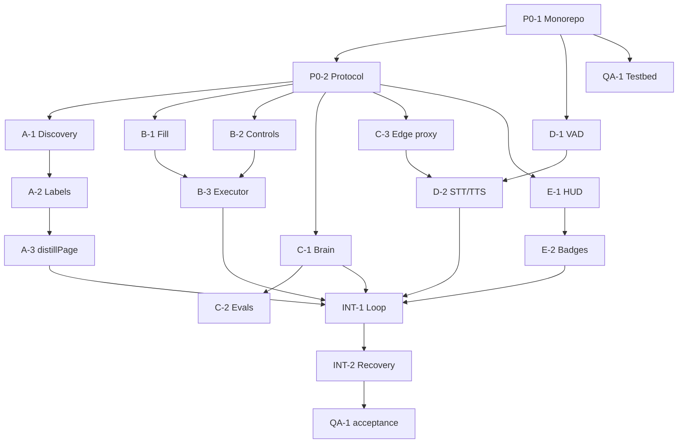

# Execution Plan

How to run this backlog with a mix of humans and coding agents (Devin, Cursor, Claude Code, OpenHands). The ticket files are the contract; this page is the schedule and the rules of engagement.

---

## 1. Dependency graph

```text
                      ┌──────────────┐
                      │    P0-1      │  Monorepo (4h)
                      └──────┬───────┘
                             ▼
                      ┌──────────────┐
                      │    P0-2      │  Protocol (6h)  ◄── gate: no track starts before merge
                      └──────┬───────┘
        ┌──────────┬─────────┼──────────┬───────────┬──────────┐
        ▼          ▼         ▼          ▼           ▼          ▼
    ┌───────┐  ┌───────┐ ┌───────┐ ┌───────┐  ┌───────┐  ┌───────┐
    │  A-1  │  │  B-1  │ │  C-1  │ │  D-1  │  │  E-1  │  │ QA-1  │
    └───┬───┘  └───┬───┘ └───┬───┘ └───┬───┘  └───┬───┘  └───────┘
        ▼          ▼         ▼         ▼          ▼
    ┌───────┐  ┌───────┐ ┌───────┐ ┌───────┐  ┌───────┐
    │  A-2  │  │  B-2  │ │  C-2  │ │  D-2  │  │  E-2  │
    └───┬───┘  └───┬───┘ └───────┘ └───┬───┘  └───┬───┘
        ▼          ▼                    │          │
    ┌───────┐  ┌───────┐  ┌───────┐     │          │
    │  A-3  │  │  B-3  │  │  C-3  │     │          │
    └───┬───┘  └───┬───┘  └───┬───┘     │          │
        └──────────┴──────────┴─────────┴──────────┘
                              ▼
                       ┌──────────────┐
                       │    INT-1     │  Master control loop (16h)
                       └──────┬───────┘
                              ▼
                       ┌──────────────┐
                       │    INT-2     │  Post-submit recovery (8h)
                       └──────┬───────┘
                              ▼
                       ┌──────────────┐
                       │ QA-1 E2E run │  5 hostile forms, 100% voice
                       └──────────────┘
```

Mermaid form (renders on GitHub):



### Critical path

`P0-1 → P0-2 → A-1 → A-2 → A-3 → INT-1 → INT-2 → QA-1 acceptance`

Estimated wall-clock with a 5-way parallel team: **~9 working days** (see §3). Everything off the critical path has slack; if you must cut scope, cut `C-2` breadth, `C-3` TTS route, and `E-1` collision heuristics — never the protocol, the executor, or the testbed.

---

## 2. Agent assignment (parallel sprint)

| Slot | Agent/Dev | Tickets | Rationale |
| --- | --- | --- | --- |
| 1 | **Lead / Architect** | `P0-1`, `P0-2`, then `INT-1`, `INT-2` | Owns the contract and the loop; only they may touch `@vfe/protocol` after freeze. |
| 2 | **DOM Engineer** | `A-1`, `A-2`, `A-3` | The Eyes are one mental model: discovery → labels → serialisation. |
| 3 | **DOM Engineer II** | `B-1`, `B-2`, `B-3` | The Hands share the event/pointer semantics; splitting A and B across agents is safe (different files, shared protocol only). |
| 4 | **Backend/AI** | `C-1`, `C-2`, `C-3` | Prompt, evals and the proxy are one deployable (`@vfe/brain`). |
| 5 | **Extension Engineer** | `D-1`, `D-2`, `E-1`, `E-2` | All four are extension-internal and share the messaging layer. |
| 6 | **QA/Frontend** | `QA-1` (from day 1), then E2E support | Testbed must exist before B-1/B-2 can be proven. |

**Conflict avoidance rules**

1. Tracks own distinct directories: `dom-engine/src/eyes/**` (A), `dom-engine/src/hands/**` (B), `brain/src/**` (C), `extension/src/**` (D + E; split by folder `audio/`, `content/hud/`, `content/badges/`).
2. Nobody edits `packages/protocol/src/**` without the architect's review (ADR-010).
3. Shared helpers are created **once, by the architect**, in P0-2 (`parse*`, `ActionErrorCode`) or in the first track that needs them (`dispatch()` in B-1 is exported for B-2 — do not duplicate).
4. `pnpm-lock.yaml` conflicts: only the architect runs `pnpm install` on `main`; track PRs must not add dependencies without asking. **Dependency budget: zero new runtime deps in `dom-engine` and `extension` beyond the ones listed in the tickets.**

---

## 3. Suggested schedule

| Day | What lands | Milestone |
| --- | --- | --- |
| 1 | `P0-1`, `P0-2` merged; `QA-1` skeleton started | `phase-0` complete |
| 2–4 | `A-1`, `A-2`; `B-1`, `B-2`; `C-1`, `C-3`; `D-1`; `E-1`; `QA-1` routes 1–3 | protocol consumers exist, first PRs green |
| 5–6 | `A-3`; `B-3`; `C-2`; `D-2`; `E-2`; `QA-1` routes 4–10 | all tracks complete |
| 7–8 | `INT-1` (loop + state machine), integration bugfixes | first end-to-end voice fill |
| 9 | `INT-2`, QA-1 acceptance run, demo recording | MVP |

---

## 4. Definition of Ready (before starting a ticket)

- All `blocked_by` tickets are **merged** (not "in review").
- The ticket's "Exact schemas"/"Public API" section has been read and questions raised **in the issue thread**, not in the PR.
- Fixtures it depends on exist (`packages/protocol/fixtures/*`, testbed routes).
- The agent has a runnable command to prove success locally (`pnpm --filter <pkg> test`, `pnpm test:e2e`).

## 5. Definition of Done (before opening the PR)

- Every acceptance-criteria checkbox in the issue is checked or explicitly deferred with a linked follow-up issue.
- Unit tests added; coverage gate met; `pnpm lint`, `pnpm typecheck`, `pnpm build` green.
- Browser tests green where the ticket requires them.
- Docs updated (`docs/**`), including the "how it works" note the ticket asks for.
- PR title `[<ID>] <title>`; PR body starts with `Closes #<issue>`; the PR links the demo artefact (video/GIF/report) when the ticket asks for one.

## 6. Issue conventions

- Title: `[P0-1] Monorepo Initialization — …` (mirrors the blueprint ID so agents can be told "work on A-2").
- Labels: `phase:*`, `track:*`, `type:*`, `priority:*`, `area:*`, `agent-ready`.
- Milestone: `Phase 0…3`.
- Every issue body is generated from the ticket file and ends with a **Live status** checklist. Editing the issue body by hand will be overwritten by the next sync — edit the ticket file instead.
- Because GitHub App installation tokens can be **create-only**, the sync script degrades gracefully: if labels/milestones cannot be attached or an existing issue cannot be patched (HTTP 403), it warns once and continues. In that situation every issue still carries its full metadata table (phase, track, owner, estimate, dependencies, unblocks) **inside the body**, and `BACKLOG.md` stays the authoritative index with issue links. Re-run `node scripts/backlog.mjs sync --apply` from a token with `issues: write` to attach labels/milestones and refresh bodies.

## 7. Kickoff prompt for a coding agent

Paste this into the agent, replacing the ticket id:

```text
You are implementing ticket <ID> in the repository jtanori/form-control-1.

1. Read docs/backlog/tickets/<ID>.md in full (frontmatter + body).
2. Read docs/architecture.md (ADRs) and packages/protocol/src if it exists.
3. Read every ticket listed under `blocked_by` to understand the interfaces you consume.
4. Implement exactly the "Technical specification". Do not add dependencies beyond those listed.
5. Write the tests described in "Test plan"; they are part of the deliverable, not optional.
6. Run: pnpm build && pnpm test && pnpm lint && pnpm typecheck (all must pass).
7. Open a PR titled "[<ID>] <title>" whose body starts with "Closes #<issue number>"
   and lists the acceptance criteria with checkmarks plus any deviations you made and why.
Do not modify packages/protocol/src without explicit approval (ADR-010).
```

---

## 8. Reconciliation notes — where this backlog improves the original blueprint

The blueprint was used verbatim where it was precise. These gaps were found during a design pass and are now specified rather than left ambiguous:

| # | Gap in the blueprint | Resolution |
| --- | --- | --- |
| 1 | **`C-3` is referenced in the graph but never specified.** | Specified as the **edge proxy & key custody** service: CORS/origin allowlist, session tokens, rate limits, STT proxying, and — critically — keeping every provider key out of the extension bundle. |
| 2 | **API keys would have shipped inside the extension.** | ADR-005: the extension holds only `EDGE_URL` + a short-lived session token; CI greps for key material. |
| 3 | **The protocol had no request/response envelope.** C-1 needs `{ pageState, transcript, conversationHistory }` but there was no schema for it. | Added `ProcessCommandRequest/Response`, `ConversationTurn`, `AgentStatus`, `ActionResult`/`ActionErrorCode` to P0-2 (required extensions, frozen alongside the originals). |
| 4 | **No error channel for actions.** B-3 must "report missing target IDs" but the protocol had no error type. | `ActionResultSchema` with a closed `ActionErrorCode` enum; the Brain can consume failures in a repair turn. |
| 5 | **`value` untyped for radios/checkboxes**, which makes "is Express selected?" unanswerable. | A-3 defines exact value semantics per type (`boolean` for checkbox/radio, array for multi-select, `'<redacted>'` for passwords). |
| 6 | **Runtime validation was unspecified.** | Every boundary parses with the protocol schemas, both client- and server-side; the Brain additionally guards `targetId` existence (ADR-008). |
| 7 | **`keypress` is deprecated** (removed in React 19 handling). | B-1 drops it from default dispatch, keeps `beforeinput`; documented, with an opt-in `legacyKeypress`. |
| 8 | **Shadow DOM `mode` unspecified** for the HUD. | ADR-006: `open` + scoped CSS, because Playwright cannot pierce closed roots and isolation is achieved by scoping. |
| 9 | **No stale-event strategy** for the control loop. | ADR-009: generation counter inside an explicit reducer (INT-1). |
| 10 | **`MutationObserver` on the document misses shadow roots** and can feedback-loop on its own attribute writes. | A-3 specifies shadow-root observation, an attribute filter, and self-mutation suppression; E-2 positions with `transform` in a single rAF. |
| 11 | **jsdom silently breaks geometry-based tests.** | P0-1 ships a `mockLayout()` helper; ADR-007 mandates Playwright for anything layout-dependent. |
| 12 | **No latency instrumentation** for the "< 400 ms / < 1200 ms" claims. | Every ticket on the latency path specifies `performance.mark`/`performance.now()` boundaries and a measurement in its PR. |
| 13 | **The 5 testbed forms are not enough to prove isolation and performance.** | QA-1 adds `/stress` (500 inputs, shadow hosts), `/hostile-css`, `/validation`, `/redirect-after-submit`. |
| 14 | **`input[type=file]` and multi-select ambiguity.** | Declared explicit non-goals (A-1, B-2) so agents do not invent scope. |
